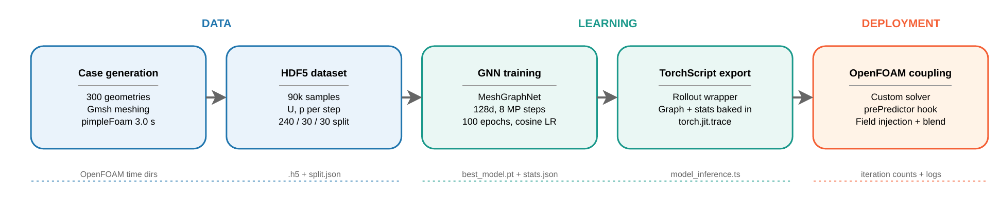

# GNN warm starts for OpenFOAM

Code for my M.Sc. thesis **"Hybrid Simulations with GNN Preconditioning for Flow Simulations"**
(RWTH Aachen University, Chair of Methods for Model-based Development in Computational Engineering, 2026).

A MeshGraphNet-style graph neural network predicts velocity and pressure fields for incompressible
flow, and OpenFOAM uses them as its starting point. The OpenFOAM solver itself is unchanged: its
linear solvers still converge to their native tolerances, so the learned field only changes where
the solve starts, not what it converges to.



## Result

On the 30-case held-out test split, initialising a steady `simpleFoam` solve with a 100-step GNN
rollout reduced:

| Rollout steps | Total linear-solver iterations | Pressure iterations | Solve time | Cases improved |
|---|---|---|---|---|
| 30  | −11.22 % | −15.24 % | −6.09 %  | 30 / 30 |
| 100 | **−17.97 %** | **−21.74 %** | −11.37 % | **30 / 30** |

What this does **not** show:

- **No end-to-end speed-up yet.** The solve runs faster after the warm start, but once the offline
  rollout is counted the warm runs are slower overall (20.7 s → 25.5 s at rollout 30 and
  → 28.8 s at rollout 100, across the test split).
- **Not useful as an in-loop transient corrector.** Blending a one-step prediction into every
  `pimpleFoam` step raised total iterations by 21.6 % at the training time step. The thesis
  explains why (Chapter 4): a fixed number of message-passing steps cannot propagate pressure
  information across the whole domain in one pass, and a field with low point-wise error need not
  satisfy the discrete continuity equations the next solve enforces.

The full analysis is in the [thesis PDF](thesis/Nain_2026_MSc_Thesis_GNN_Preconditioning.pdf).

## Method

- **Data.** 300 parametric backward-facing-step geometries, meshed automatically with Gmsh
  (8k–12k cells) and simulated with `pimpleFoam` for 3.0 s; about 90k samples of `Ux`, `Uy` and
  `p` per time step, split 240 / 30 / 30 by geometry.
- **Model.** MeshGraphNet-style encoder–processor–decoder in PyTorch / PyTorch Geometric:
  128-dimensional latent space and 8 message-passing steps. It predicts one-step increments
  `ΔUx, ΔUy, Δp_gauge`, so a rollout chains predictions. Trained for 100 epochs with a cosine
  learning-rate schedule (best validation loss 0.00719).
- **Coupling.** The model is exported with TorchScript and loaded from C++
  (`libIterReduceCoupling`). It is used either inside a custom solver
  (`iterReduceIncompressibleFluid`, a pre-predictor hook that injects and blends fields), or
  offline to write a warm-start field into the case's `0/` directory before a stock solve.

## Repository layout

```
gnn_preconditioner/
├── data_generation/   parametric cases, Gmsh meshing, OpenFOAM runs, HDF5 dataset builder
├── manifests/         case parameters and the 240/30/30 split
├── training/          GNN model, training, evaluation, TorchScript export
├── inference/         context building, rollouts, OpenFOAM field I/O, benchmark runners
├── openfoam_solver/   C++ coupling library and custom OpenFOAM solvers
├── benchmarks/        benchmark scripts, evidence map and result tables
└── docs/              dataset and mesh-profile schemas
thesis/                submitted thesis (PDF)
```

`gnn_preconditioner/README.md` has the step-by-step commands for each stage.

## Running it

Tested with OpenFOAM 12, Gmsh 4.13, Python 3.12, PyTorch 2.5.1 (CUDA 12.1 wheels) and
PyTorch Geometric 2.7.0. Training ran on an NVIDIA H100.

- `gnn_preconditioner/setup_env.sh` loads these through the module system of the RWTH CLAIX
  cluster. On another machine, install the same versions and source OpenFOAM yourself.
- **Data:** the generated cases and HDF5 dataset (about 15 GB) are not in this repository. The
  scripts in `data_generation/` regenerate them from `manifests/`.
- **Trained model:** download `full_surface_coarse_v1_t3p0_state_hd128_seed1337_run1.zip` from the
  [Releases](../../releases) page and unpack it into `gnn_preconditioner/checkpoints/`. It is the
  checkpoint behind every benchmark in the thesis.

Typical steady warm-start benchmark, once the environment and checkpoint are in place:

```bash
source gnn_preconditioner/setup_env.sh --runtime-only
CKPT=gnn_preconditioner/checkpoints/full_surface_coarse_v1_t3p0_state_hd128_seed1337_run1
python3 gnn_preconditioner/training/run_evaluation.py \
  --checkpoint-path "$CKPT/best_model.pt" --stats-path "$CKPT/stats.json" \
  --dataset-path gnn_preconditioner/data_generation/datasets/iterreduce_full_surface_coarse_v1_t3p0.h5 \
  --split-path gnn_preconditioner/manifests/full_split_240_30_30_v1.json \
  --split test --rollout-steps 100 --device cuda
```

## Acknowledgements

Supervised by Ingo Steldermann and Prof. Dr. Julia Kowalski at the Chair of Methods for
Model-based Development in Computational Engineering, RWTH Aachen University, whose project
template this repository started from. Computations were performed with computing resources
granted by RWTH Aachen University. The model architecture follows MeshGraphNets
(Pfaff et al., *Learning Mesh-Based Simulation with Graph Networks*, ICLR 2021).

## Citation

```
A. Nain, "Hybrid Simulations with GNN Preconditioning for Flow Simulations",
M.Sc. thesis, RWTH Aachen University, 2026.
```

## License

GPL-3.0. See [LICENSE](LICENSE).
