# GNN warm starts for OpenFOAM

Code for my M.Sc. thesis **"Hybrid Simulations with GNN Preconditioning for Flow Simulations"**
(RWTH Aachen University, Chair of Methods for Model-based Development in Computational Engineering, 2026).
The figures below are from the colloquium presentation; the full
[thesis](thesis/Nain_2026_MSc_Thesis_GNN_Preconditioning.pdf) and
[slides](thesis/Nain_2026_MSc_Colloquium_GNN_Preconditioning.pdf) are in `thesis/`.

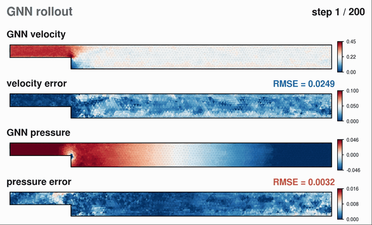

*The trained GNN rolling itself forward on an unseen geometry: predicted velocity and pressure,
and their error against OpenFOAM.*

## The idea

Every CFD time step turns into a large sparse linear system that an iterative solver grinds down to
a tolerance, and that work dominates the run time. A better starting guess means fewer iterations.
Here a graph neural network is the **predictor**: it proposes a field close to the next solution.
OpenFOAM stays the **corrector**: it runs its normal solver to its normal tolerance from that
start. The network never replaces the solver, so the converged answer is still OpenFOAM's; the
question is only whether the learned guess lands closer than OpenFOAM's default guess, which is
simply the previous step.

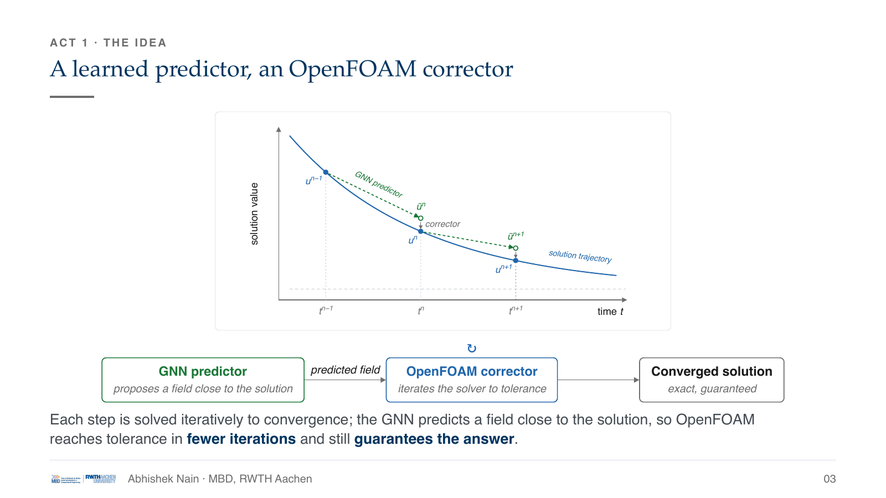

## Why a graph neural network

The finite-volume mesh already is a graph: every cell becomes a node and every internal face an
edge, which is exactly the connectivity the solver assembles into its matrix. The network runs
directly on that mesh, with no pixel grid, no resampling and no loss of the boundary-fitted shape.
Message passing between neighbouring cells mirrors how a finite-volume cell balances fluxes across
its faces.

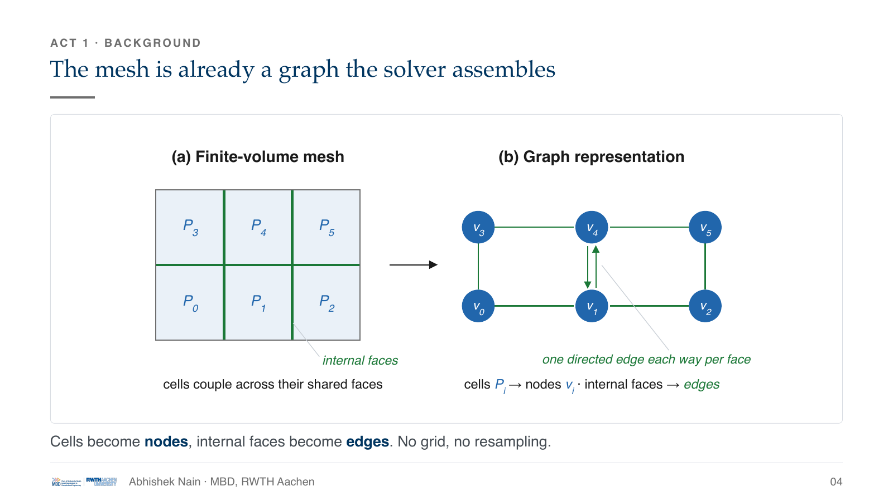

## Model

A MeshGraphNet-style encoder, 8 message-passing processor blocks and a decoder (PyTorch / PyTorch
Geometric, 128-dimensional latent, about 1.29 M parameters). It predicts the **increment**
`ΔUx, ΔUy, Δp` that takes the current field one step ahead, rather than the full solution; a
rollout feeds each prediction back in as the next input.

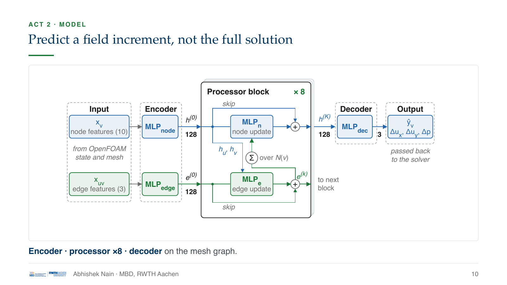

## Pipeline and data

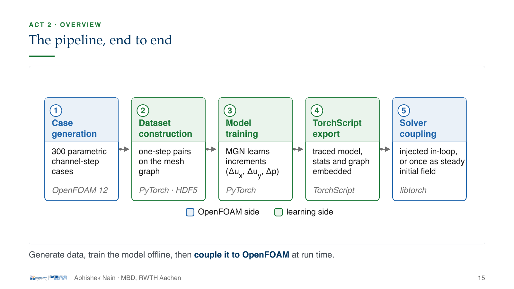

- **Data.** 300 laminar backward-facing-step channels (Re_h ≈ 67 to 386), sampled with a Latin
  hypercube over inlet velocity (0.10 to 0.40 m/s), step height (8 to 15 mm) and step length
  (60 to 100 mm). Each case is meshed automatically with Gmsh (3,159 to 3,417 cells per case, so the
  graph has that many nodes) and run in `pimpleFoam` for 3 s. That gives 88,064 one-step
  transitions, split **by geometry** into 240 training, 30 validation and 30 test cases, so every
  result below is on geometries the model never saw.
- **Training.** One step ahead, 100 epochs with a cosine learning-rate schedule; best validation
  loss 0.0072.
- **Coupling.** The model is traced with TorchScript (rollout and normalisation stats baked in) and
  loaded from C++ through `libIterReduceCoupling`.

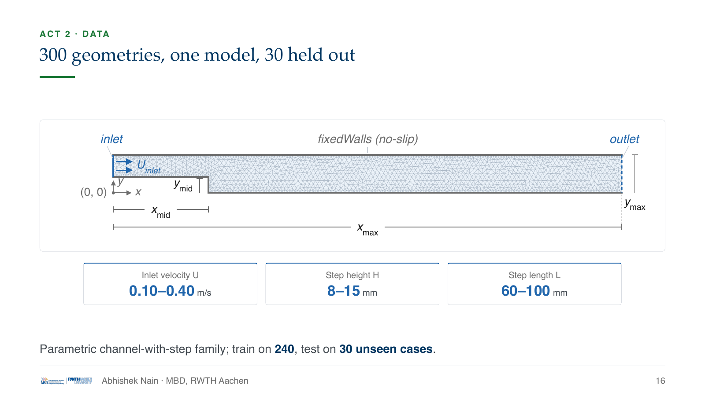

## Two ways to use it

**(b) Repeated learned guess:** inject a fresh prediction at every transient time step, through a
hook at the start of the first outer PIMPLE iteration in a custom solver
(`iterReduceIncompressibleFluid`). **(c) One-time learned start:** roll the model out once to a
developed field and write it as the initial condition of a stock steady `simpleFoam` solve.
Control runs confirm the coupling itself is neutral: passing the field through unchanged costs no
iterations, while a deliberately bad all-zero field adds about 13 %.

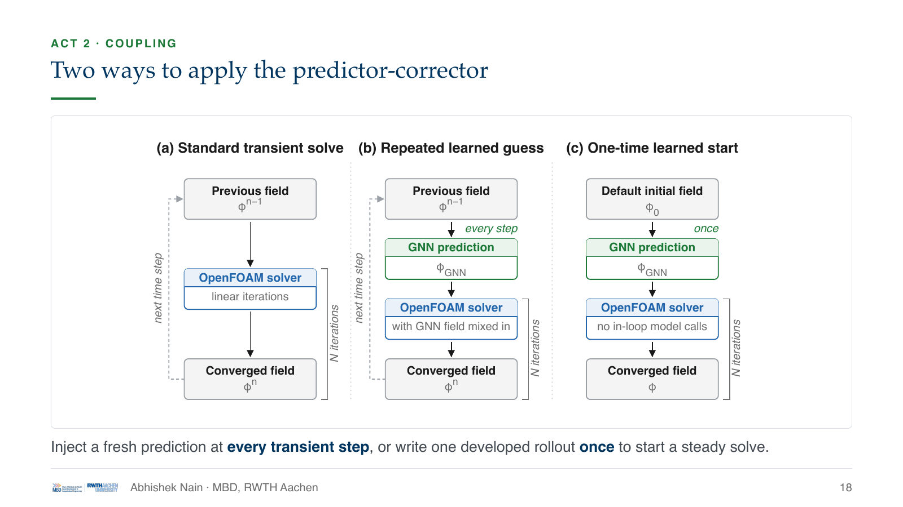

## Results

**As a one-time steady warm start, it works in every case.** On the 30 test geometries:

| Rollout steps | Total linear-solver iterations | Pressure iterations | Solve time | Cases improved |
|---|---|---|---|---|
| 30  | −11.22 % | −15.24 % | −6.09 %  | 30 / 30 |
| 100 | **−17.97 %** | **−21.74 %** | −11.37 % | **30 / 30** |

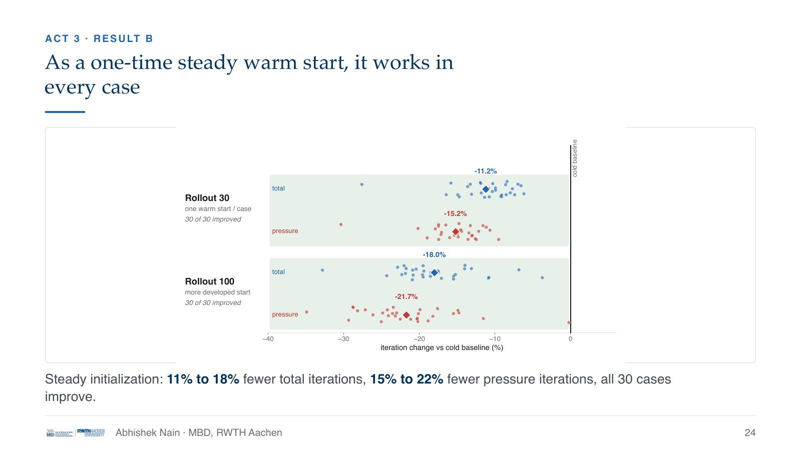

**Injected at every transient step, it makes things worse:** +21.6 % total iterations at the
matched time step (1 of 30 cases improved), +18.0 % at a finer step with a 0.2 blend (none
improved).

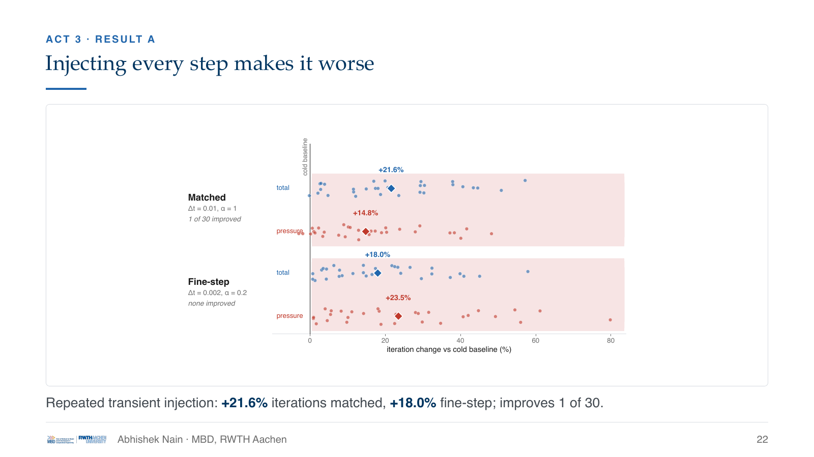

**Why the difference.** About 90 % of the pressure prediction error sits at the largest, domain-wide
scale, which a fixed 8-hop network cannot reach in one pass. Injected every step, that global error
returns every step; as a one-time warm start, the solver only has to correct it once. A field with
low point-wise error also need not satisfy the discrete continuity equations the next solve
enforces.

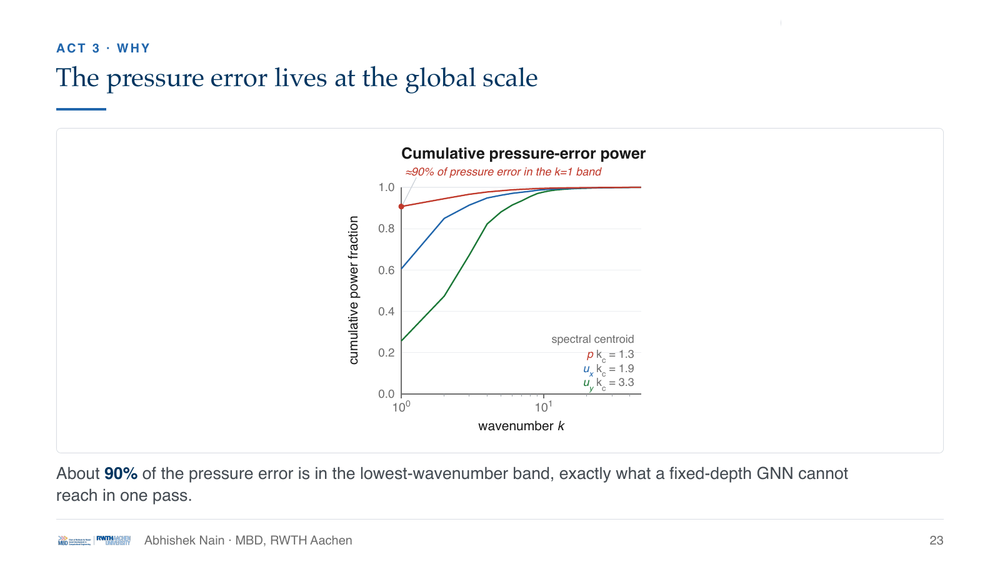

**What this is not: an end-to-end speed-up.** The solve itself runs faster after the warm start,
but model loading, the forward pass and field handling add time; once the offline rollout is
counted, the warm runs are slower overall (20.7 s → 25.5 s at rollout 30, → 28.8 s at rollout 100,
across the test split).

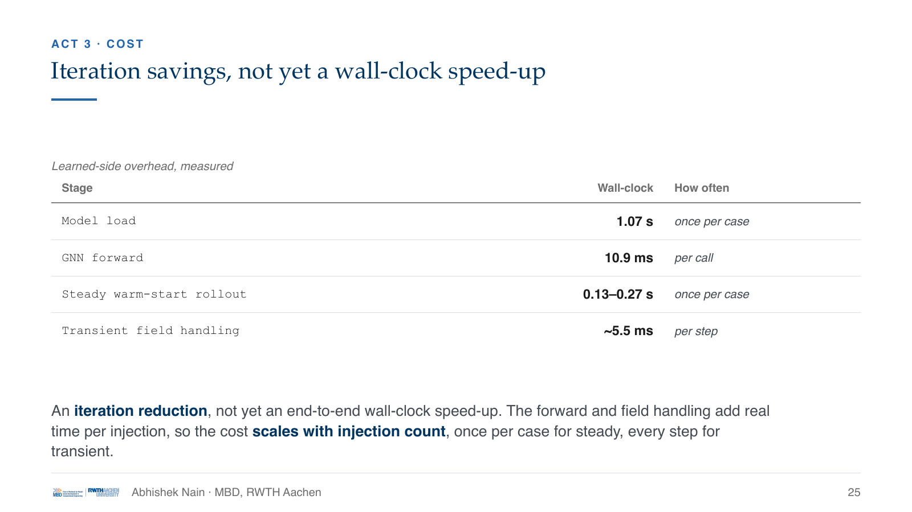

## What it shows, and what comes next

- An end-to-end, non-intrusive GNN-to-OpenFOAM coupling: data generation, training and in-solver
  injection, with a model-agnostic interface, so a better model drops in without re-engineering.
- A learned warm start cuts steady-solver iterations in every unseen test case.
- The limit is in the model, not the framework: a one-step, field-error model does not capture the
  global pressure mode. Next steps are training for solver response (unrolled or
  differentiable-solver losses), giving the model global reach (deeper or multiscale message
  passing, or a learned preconditioner), and then harder regimes: higher Reynolds numbers, tighter
  tolerances, 3D.

## Repository layout

```
gnn_preconditioner/
├── data_generation/   parametric cases, Gmsh meshing, OpenFOAM runs, HDF5 dataset builder
├── manifests/         case parameters and the 240/30/30 split
├── training/          GNN model, training, evaluation, TorchScript export
├── inference/         context building, rollouts, OpenFOAM field I/O, benchmark runners
├── openfoam_solver/   C++ coupling library and custom OpenFOAM solvers
├── benchmarks/        benchmark scripts, evidence map and result tables
└── docs/              dataset and mesh-profile schemas
docs/figures/          figures used in this README (from the colloquium slides)
thesis/                submitted thesis and colloquium slides (PDF)
```

`gnn_preconditioner/README.md` has the step-by-step commands for each stage.

## Running it

Tested with OpenFOAM 12, Gmsh 4.13, Python 3.12, PyTorch 2.5.1 (CUDA 12.1 wheels) and
PyTorch Geometric 2.7.0. Training ran on an NVIDIA H100.

- `gnn_preconditioner/setup_env.sh` loads these through the module system of the RWTH CLAIX
  cluster. On another machine, install the same versions and source OpenFOAM yourself.
- **Data:** the generated cases and HDF5 dataset (about 15 GB) are not in this repository. The
  scripts in `data_generation/` regenerate them from `manifests/`.
- **Trained model:** download `full_surface_coarse_v1_t3p0_state_hd128_seed1337_run1.zip` from the
  [Releases](../../releases) page and unpack it into `gnn_preconditioner/checkpoints/`. It is the
  checkpoint behind every benchmark in the thesis.

Typical evaluation run, once the environment and checkpoint are in place:

```bash
source gnn_preconditioner/setup_env.sh --runtime-only
CKPT=gnn_preconditioner/checkpoints/full_surface_coarse_v1_t3p0_state_hd128_seed1337_run1
python3 gnn_preconditioner/training/run_evaluation.py \
  --checkpoint-path "$CKPT/best_model.pt" --stats-path "$CKPT/stats.json" \
  --dataset-path gnn_preconditioner/data_generation/datasets/iterreduce_full_surface_coarse_v1_t3p0.h5 \
  --split-path gnn_preconditioner/manifests/full_split_240_30_30_v1.json \
  --split test --rollout-steps 100 --device cuda
```

## Acknowledgements

Supervised by Ingo Steldermann and Prof. Dr. Julia Kowalski at the Chair of Methods for
Model-based Development in Computational Engineering, RWTH Aachen University, whose project
template this repository started from. Computations were performed with computing resources
granted by RWTH Aachen University. The model architecture follows MeshGraphNets
(Pfaff et al., *Learning Mesh-Based Simulation with Graph Networks*, ICLR 2021).

## Citation

```
A. Nain, "Hybrid Simulations with GNN Preconditioning for Flow Simulations",
M.Sc. thesis, RWTH Aachen University, 2026.
```

## License

GPL-3.0. See [LICENSE](LICENSE).
